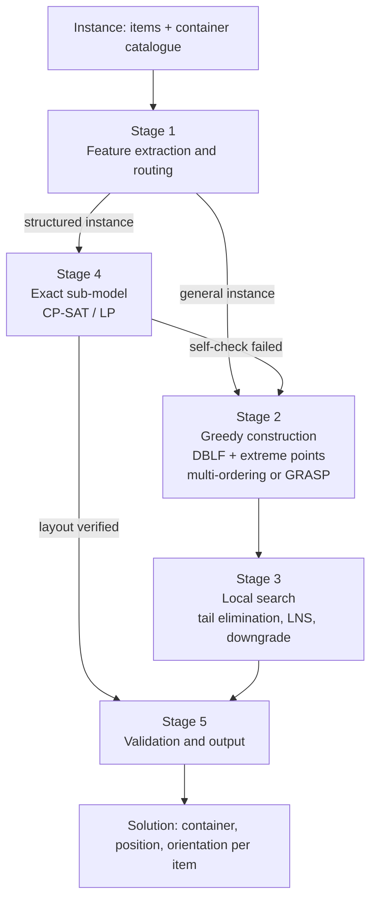
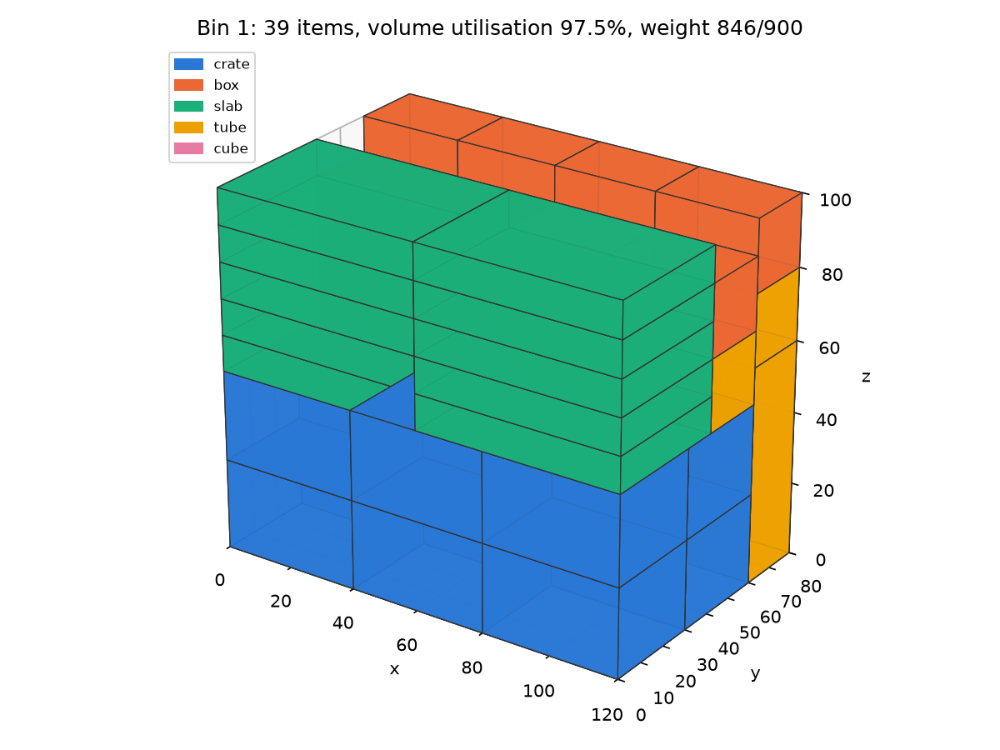
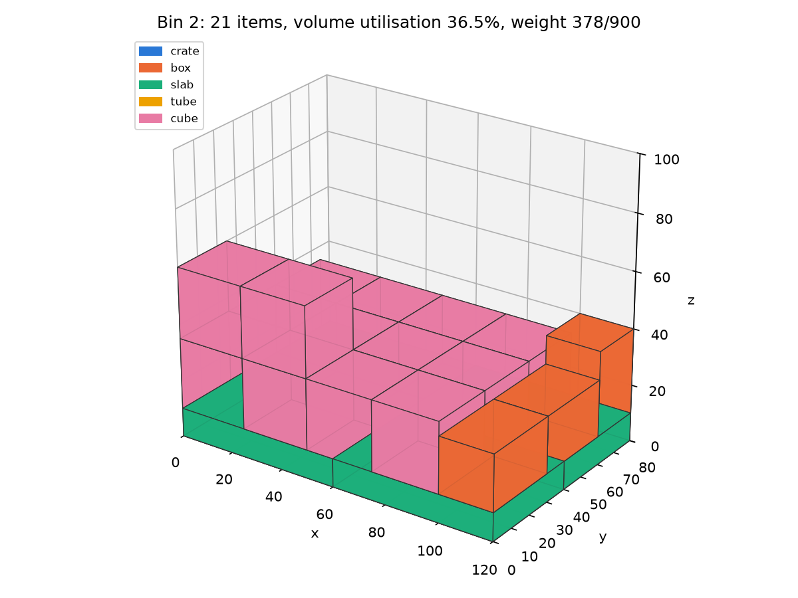

# 3D Bin Packing Optimization

> **Confidentiality note.** The core solver and the industrial datasets are not included in this public repository, due to course policies and the confidentiality of company data. The full source code is available on request for academic evaluation.

A heuristic solver for the **heterogeneous three-dimensional bin packing problem**: a set of rectangular items with weight, value and rotation restrictions has to be loaded into containers of different types and costs, so that every item is placed, no two items overlap, the load limits of each container are respected, and every item is physically supported from below. The objective is to minimise the total cost of the containers used. The solver was developed as a team project for the Operations Research course at Politecnico di Torino, where it ranked **4th out of 55 teams**, and was later adapted by me, as individual work, to real packing orders of a manufacturing company. This repository documents the problem, the mathematical model and the multi-stage heuristic, and ships a small simplified demo so that the ideas can be seen running. 

---

## Contents

1. [Problem statement](#problem-statement)
2. [Mathematical formulation](#mathematical-formulation)
3. [Algorithm architecture](#algorithm-architecture)
4. [Results](#results)
5. [Demo](#demo)
6. [Team and credits](#team-and-credits)
7. [License](#license)

---

## Problem statement

**Input**

- A catalogue of **container types** $t \in T$. Each type has inner dimensions (width, depth, height), a maximum load weight, an optional maximum total value, a fixed cost per container opened, and a *support strength* $g_t \in [0,1]$: the minimum fraction of an item's base area that must rest on the container floor or on the top faces of other items. An unlimited number of containers of each type may be opened.
- A set of **items** $i \in I$. Each item is a rectangular box with nominal dimensions $(w_i, d_i, h_i)$, a weight $m_i$, a value $v_i$, and a set of **allowed orientations** $R_i \subseteq \{0,\dots,5\}$. The six orientation codes are the six axis-aligned permutations of the nominal dimensions.

**Output**

For every item: the container that hosts it, its position (the coordinates of its lower-front-left corner) and its orientation code.

**Goal**

Minimise the sum of the costs of the containers opened. A container costs the same whether it is full or nearly empty, so the problem rewards both opening few containers and choosing the cheapest type that fits a given load.

The same model, with company-specific container catalogues and item lists, was used in the industrial adaptation.

---

## Mathematical formulation

The following formulation describes exactly the constraints enforced by the implementation. Let $B$ be a sufficiently large set of candidate containers, each with a type $\tau(b) \in T$ and attributes $(W_b, D_b, H_b)$ (inner width, depth, height), $M_b$ (maximum weight), $V_b$ (maximum value, $+\infty$ when not specified), $c_b$ (cost) and $g_b$ (support strength).

**Orientations.** For item $i$ and orientation code $k \in \{0,\dots,5\}$, let $\ell_{ik}(x), \ell_{ik}(y), \ell_{ik}(z)$ denote the extents of the item along the three axes. They are the permutation of $(w_i, d_i, h_i)$ selected by $k$:

| $k$ | extent along $x$ | extent along $y$ | extent along $z$ |
|:---:|:---:|:---:|:---:|
| 0 | $w_i$ | $d_i$ | $h_i$ |
| 1 | $d_i$ | $w_i$ | $h_i$ |
| 2 | $w_i$ | $h_i$ | $d_i$ |
| 3 | $h_i$ | $d_i$ | $w_i$ |
| 4 | $d_i$ | $h_i$ | $w_i$ |
| 5 | $h_i$ | $w_i$ | $d_i$ |

**Decision variables**

- $y_b \in \{0,1\}$: container $b$ is opened.
- $a_{ib} \in \{0,1\}$: item $i$ is assigned to container $b$.
- $r_{ik} \in \{0,1\}$: item $i$ uses orientation $k$.
- $(x_i, y_i, z_i) \in \mathbb{R}^3_{\ge 0}$: position of the lower-front-left corner of item $i$ inside its container.

**Objective**

$$
\min \sum_{b \in B} c_b \, y_b
$$

**Constraints**

Each item is placed in exactly one container, and only in an opened one:

$$
\sum_{b \in B} a_{ib} = 1 \quad \forall i \in I, \qquad a_{ib} \le y_b \quad \forall i \in I,\ b \in B
$$

Each item uses exactly one orientation, taken from its allowed set:

$$
\sum_{k \in R_i} r_{ik} = 1 \quad \forall i \in I, \qquad r_{ik} = 0 \quad \forall i \in I,\ k \notin R_i
$$

Effective extents of item $i$ along the axes:

$$
L_i^{x} = \sum_{k} r_{ik}\, \ell_{ik}(x), \qquad
L_i^{y} = \sum_{k} r_{ik}\, \ell_{ik}(y), \qquad
L_i^{z} = \sum_{k} r_{ik}\, \ell_{ik}(z)
$$

Items stay inside their container:

$$
x_i + L_i^{x} \le \sum_{b} a_{ib} D_b, \qquad
y_i + L_i^{y} \le \sum_{b} a_{ib} W_b, \qquad
z_i + L_i^{z} \le \sum_{b} a_{ib} H_b \qquad \forall i \in I
$$

Two items in the same container do not overlap (at least one of the six separating conditions holds):

$$
a_{ib} + a_{jb} \le 1 \;\;\lor\;\;
x_i + L_i^{x} \le x_j \;\lor\; x_j + L_j^{x} \le x_i \;\lor\;
y_i + L_i^{y} \le y_j \;\lor\; y_j + L_j^{y} \le y_i \;\lor\;
z_i + L_i^{z} \le z_j \;\lor\; z_j + L_j^{z} \le z_i
\qquad \forall i < j,\ b \in B
$$

Weight and value capacity of each container:

$$
\sum_{i \in I} m_i \, a_{ib} \le M_b \, y_b, \qquad
\sum_{i \in I} v_i \, a_{ib} \le V_b \, y_b \qquad \forall b \in B
$$

Vertical support. An item on the floor ($z_i = 0$) is always supported. Otherwise the area of its base covered by the top faces of items directly beneath it, in the same container, must reach the fraction $g_b$ of the base area:

$$
z_i = 0 \;\;\lor\;\; \sum_{\substack{j \ne i \\ z_j + L_j^{z} = z_i}} a_{ib}\,a_{jb}\, \text{overlap}_{xy}(i, j) \;\ge\; g_b \, L_i^{x} L_i^{y}
\qquad \forall i \in I,\ b \in B
$$

where $\text{overlap}_{xy}(i,j)$ is the area of the intersection of the two items' footprints on the horizontal plane.

The disjunctive and bilinear constraints make the exact model intractable at the sizes of interest (hundreds to thousands of items), which motivates the heuristic approach below. Exact optimisation is used only on small, well-structured sub-problems.

---

## Algorithm architecture

The solver is a **multi-stage heuristic**: a cheap structural analysis of the instance selects a packing strategy, a greedy constructive phase builds a feasible solution, and a local search phase then reduces the number and cost of the containers. All stages share the same feasibility kernel (bounds, overlap, weight, value, support) and the whole run is bounded by a time limit.

### Stage 1. Instance analysis and routing

A small set of structural features is computed from the item list and the container catalogue:

- which capacity binds first (volume, weight or value) with respect to the cheapest container per unit volume;
- number of items and number of distinct item shapes;
- fraction of zero-weight items;
- whether the catalogue consists of identical containers.

A deterministic decision tree maps the feature vector to one of several packing strategies. Every strategy is a complete solver and falls back to the general-purpose strategy when its structural assumptions are not met, so any instance yields a feasible solution.

### Stage 2. Greedy construction

The general strategy is a **deepest-bottom-left-fill** construction over **extreme points**. Items are processed in a given order; for each item, the open containers are scanned and, inside each container, the candidate corner points are tried from the lowest, frontmost, leftmost one. The first allowed orientation that passes all feasibility checks is committed, and the three corners generated by the placed box become new candidate points. If no open container accepts the item, a new container is opened, preferring the type with the best cost-to-volume ratio among those that can hold the item.

The construction is run with **many item orderings** (by height, base area, volume, longest side, shape frequency, and a set of seeded random permutations) and the cheapest resulting packing is kept. A **GRASP** variant, used for instances that do not match any known structure, replaces the fixed ordering with a restricted candidate list and runs several independent randomised constructions in parallel.

### Stage 3. Local search

Starting from the best constructed packing, three families of moves reduce the cost:

- **Tail elimination.** Try to empty the least-filled container by relocating its items into the free space of the other containers, then close it.
- **Destroy and repair (large neighbourhood search).** Remove a small group of containers, pool their items, and rebuild them with different orderings, accepting the result when it uses fewer or cheaper containers.
- **Container downgrade.** Repack the items of a container into a cheaper container type when they fit.

The GRASP variant additionally merges pairs of lightly filled containers and splits expensive containers into cheaper ones.

### Stage 4. Exact sub-models for structured instances

Some strategies replace part of the greedy construction with small exact models solved by a constraint programming or linear programming engine (Google OR-Tools):

- optimal single-cell patterns when all containers are identical and the items come in few shapes;
- wall-building plus a minimum-cost assignment of walls to containers;
- column generation for instances where weight and value, not geometry, are the binding resources;
- cutting-stock models for sets of over-sized items that force the use of a larger container type;
- shelf-based assignment for items that stack into full-width columns.

Each exact sub-model is guarded by a structural test and by a geometric self-check of the resulting layout; on any failure the strategy falls back to Stage 2 and 3.

### Stage 5. Validation and output

The final layout is checked against all constraints of the formulation and written out as one row per item: container type and index, item id, position and orientation code.



---

## Results

**Course benchmark.** The course provided 20 instances with 50 to 2000 items and up to 5 container types each, with a 10-minute time limit per instance. The solver produced feasible solutions on all 20 instances and ranked **4th out of 55 teams** on the course's total-cost ranking.

**Industrial adaptation.** The solver was adapted and tested on real packing orders of a manufacturing company. Those datasets and figures are confidential and are not reported here.

**Simplified demo.** Running the demo in this repository (fixed seed, 60 synthetic items, identical bins) gives:

```
Simplified 3D bin packing demo (not the original solver)
seed=7  items=60  bin=(120.0, 80.0, 100.0)  max weight=900.0  min support=70%
bins used: 2   (volume lower bound: 2)
  bin 1: 39 items, volume utilisation  97.5%, weight  845.6/900
  bin 2: 21 items, volume utilisation  36.5%, weight  378.3/900
overall volume utilisation: 67.0%
self-check: all constraints verified (bounds, overlap, orientation, weight, support)
```

| | |
|---|---|
|  |  |

The demo implements only the Stage 2 construction with a single fixed ordering. The numbers above are those of the demo, not of the original solver.

---

## Demo

[`demo.py`](demo.py) is a deliberately **simplified, self-contained re-implementation** written for this repository. It is not the original solver and shares no code with it. It illustrates the data model (items with allowed orientations and weight, bins with a weight limit and a minimum support fraction) and the greedy corner-point placement of Stage 2, on randomly generated items with a fixed seed. It then prints the volume utilisation of each bin and saves 3D renderings to `images/`.

Requirements: Python 3.10 or newer, `numpy`, `matplotlib`.

```bash
git clone https://github.com/pbdsch/3d-bin-packing-optimization.git
cd 3d-bin-packing-optimization
python -m venv .venv
source .venv/bin/activate        # on Windows: .venv\Scripts\activate
pip install -r requirements.txt
python demo.py
```

The run takes a few seconds and overwrites `images/bin_1.png` and `images/bin_2.png`. Change `SEED`, `N_ITEMS`, `BIN_SIZE` or `ITEM_FAMILIES` at the top of the file to generate other instances.

---

## Team and credits

The project began as a team project for the **Operations Research** course at **Politecnico di Torino**. The team members were:

- Riccardo Capodoglio
- Chiara Pasquero
- Luigi Silinguelli
- Piero Bedeschi

The subsequent industrial adaptation of the solver to real packing orders, carried out during a summer project at a manufacturing company, was my individual work.

---

## License

The contents of this repository (documentation and the simplified demo) are released under the [MIT License](LICENSE). The original solver is not part of this repository and is not covered by this license.
